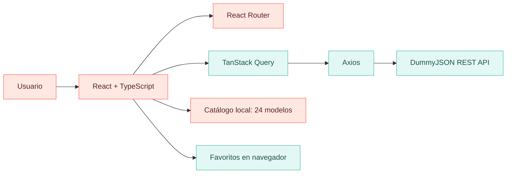

<div align="center">


### 👟 Un catálogo de zapatillas que combina diseño, tecnología y experiencia de usuario

**Nike · Adidas · Jordan · New Balance**

[](https://github.com/paulbellido0990/SneakerStore)
[](#-sobre-el-proyecto)


</div>

---

## ✨ Sobre el proyecto

**SneakerStore PRO** es una aplicación web académica para explorar zapatillas de **Nike, Adidas, Jordan y New Balance**, con una interfaz en español, diseño adaptable y precios referenciales en **soles peruanos (S/)**.

El proyecto fue desarrollado para el **Laboratorio N.º 07 de Desarrollo Web (IS-882)**, integrando consumo de API REST, asincronía, tipado estricto y enrutamiento dinámico.

> [!IMPORTANT]
> **Proyecto demostrativo.** No se realizan compras, pagos, reservas ni pedidos. Los precios y los productos seleccionados son de carácter académico y no representan inventario ni ofertas oficiales.

<div align="center">

| 👟 24 modelos seleccionados | 🏷️ 4 marcas | 🇵🇪 Precios en S/ | 📱 Diseño adaptable |
|:---:|:---:|:---:|:---:|
| 6 por marca | Nike · Adidas · Jordan · New Balance | Moneda PEN | Móvil · Tablet · PC |

</div>

## 🛍️ Descubre las marcas

<div align="center">

| **NIKE** | **ADIDAS** | **JORDAN** | **NEW BALANCE** |
|:---:|:---:|:---:|:---:|
| Deportes y estilo urbano | Clásicos y tendencias | Inspiración basketball | Confort y diseño |
| [Explorar catálogo](#-funcionalidades) | [Explorar catálogo](#-funcionalidades) | [Explorar catálogo](#-funcionalidades) | [Explorar catálogo](#-funcionalidades) |

</div>

## 🚀 Funcionalidades

- 🔎 **Búsqueda inteligente:** *debouncing* de 400 ms para procesar la búsqueda después de una pausa.
- 🎛️ **Filtros combinables:** marca, género, estilo y rango de precios.
- ↕️ **Ordenamiento:** consulta modelos por nombre o precio.
- 📄 **Paginación:** ocho productos por página, con estado reflejado en la URL.
- ❤️ **Favoritos:** almacenamiento de preferencias en el navegador.
- 🧭 **Navegación dinámica:** catálogo y detalle individual mediante React Router.
- ⚡ **Caché y prefetching:** TanStack Query permite gestionar datos asíncronos y precargar detalles.
- 🌐 **Integración REST:** Axios obtiene productos adicionales de DummyJSON cuando están disponibles.
- 🛟 **Experiencia resiliente:** manejo de carga, errores, productos inexistentes e imágenes alternativas.
- 📱 **Responsive:** interfaz adaptada a dispositivos de distintos tamaños.

## 🧰 Tecnologías utilizadas

<div align="center">


</div>

## 🧭 Arquitectura del catálogo



**Origen de los datos:** la aplicación combina un catálogo local de **24 zapatillas seleccionadas** con productos adicionales obtenidos de [DummyJSON](https://dummyjson.com/docs/products), filtrados según las marcas y categorías admitidas. Los precios en soles son **simulados**, no conversiones comerciales verificadas.

## 📁 Estructura principal

```text
SneakerStore/
├── public/
├── src/
│   ├── api/
│   │   └── products.ts          # Cliente REST, Axios y adaptación
│   ├── components/             # Layout, tarjetas e imágenes
│   ├── context/
│   │   └── Favoritos.tsx       # Preferencias del navegador
│   ├── data/
│   │   └── catalogo.ts         # 24 modelos seleccionados
│   ├── hooks/
│   │   └── useDebounce.ts      # Retardo de búsqueda
│   ├── pages/
│   │   ├── Catalog.tsx         # Filtros, búsqueda y paginación
│   │   └── ProductDetail.tsx   # Detalle de zapatilla
│   ├── types/
│   │   └── product.ts          # Interfaces TypeScript
│   ├── utils/
│   │   └── format.ts           # Formato monetario es-PE
│   ├── main.tsx
│   └── styles.css
├── package.json
└── README.md
```

## 💻 Instalación y ejecución

**Requisito previo:** Node.js compatible con la versión de Vite del proyecto (recomendado Node.js 20.19+ o 22.12+).

**1. Clona el repositorio**

```bash
git clone https://github.com/paulbellido0990/SneakerStore.git
cd SneakerStore
```

**2. Instala las dependencias**

```bash
npm install
```

**3. Inicia la aplicación**

```bash
npm run dev
```

Abre la URL mostrada por Vite, normalmente **http://localhost:5173**.

**4. Verifica la compilación**

```bash
npm run build
```

## 🧪 Pruebas recomendadas

| Prueba | Resultado esperado |
|---|---|
| Buscar `Samba` | Aparece el modelo que coincide con la búsqueda |
| Elegir `New Balance` | Se muestran zapatillas de esa marca |
| Cambiar de página | Se actualiza `pagina` en la URL |
| Entrar al detalle | Se muestra información del producto seleccionado |
| Marcar como favorito | El estado se conserva en el navegador |
| Acceder a un ID inválido | Se muestra un mensaje de producto no encontrado |
| Ejecutar `npm run build` | Permite comprobar la compilación local |

Consulta también [`GUIA_DE_PRUEBAS.md`](./GUIA_DE_PRUEBAS.md) para el procedimiento de validación académica.

## 📚 Aprendizajes del Laboratorio 07

- Consumo asíncrono de APIs REST con Axios.
- Tipado de interfaces y datos externos mediante TypeScript.
- Gestión de estados, caché y consultas con TanStack Query.
- Rutas dinámicas y parámetros de URL con React Router.
- Aplicación de debouncing, paginación y prefetching.
- Separación de responsabilidades en componentes, hooks y módulos.

## 👨‍💻 Autor

<div align="center">

**Llallahui Bellido Paul Modesto**  
Estudiante de Ingeniería de Sistemas  
Universidad Nacional de San Cristóbal de Huamanga — UNSCH

[](https://github.com/paulbellido0990)

**IS-882 · Desarrollo Web · Laboratorio 07 · 2026-II**


<sub>Desarrollado con fines educativos. Las marcas e imágenes pertenecen a sus respectivos titulares.</sub>

</div>
